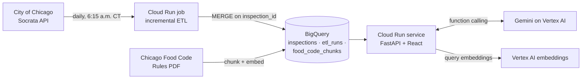

# Chicago Food Inspections

**[Live app](https://food-inspections-p73umfq4ta-uc.a.run.app)**

A dashboard and an AI analyst for City of Chicago food inspection data. Ask a question in plain English, such as *"What was the most cited violation in 2025, and what does the code require?"*, and the agent looks up the answer in the inspection records, finds the rule in the Chicago Food Code, and shows every lookup it made.


## What it does

- **Answers questions with real numbers.** A Gemini model on Vertex AI picks from five read-only BigQuery tools (citywide totals, fail rates by ZIP code, year-over-year ZIP changes, most cited violations, business lookup) and fills in their arguments. It never writes SQL.
- **Cites the rules.** A sixth tool searches 373 sections of the Chicago Food Code Rules with vector search in BigQuery, so answers name the section behind each requirement.
- **Shows its work.** Each lookup streams to the page as it runs, with its arguments, row count and timing.
- **Stays current.** A Cloud Run job loads new and corrected inspections every morning; the page shows the newest inspection date and when the data last refreshed.
- **Answers four questions at a glance.** Whether the fail rate is rising or falling, what goes wrong most often, which ZIP codes have the highest and lowest fail rates, and which kinds of business fail most.

## Architecture



| Layer | Technology |
| --- | --- |
| Data | Python ETL, BigQuery (MERGE upserts, month partitions), Cloud Scheduler, Cloud Run jobs |
| Agent | Gemini on Vertex AI with function calling, `gemini-embedding-001`, BigQuery `VECTOR_SEARCH` |
| API | FastAPI, newline-delimited JSON streaming |
| Frontend | React 18, Recharts, Vite |
| Infrastructure | Terraform (38 resources), Cloud Run, Artifact Registry, Cloud Build, Workload Identity Federation |
| Quality | Python `unittest`, agent eval suite, GitHub Actions |

## How the agent answers

1. The question passes a length check, then goes to the model with descriptions of six tools.
2. The model chooses a tool and arguments. Arguments are validated (years, Chicago ZIP codes, limits) and bound as query parameters, so every query is a fixed, read-only `SELECT`.
3. Results go back to the model, which may call another tool. It gets at most six lookups per question.
4. The final answer is checked: every number in it must appear in a tool result, and any that don't are flagged on the page.

**Guardrails:** text in retrieved passages or records that reads like instructions ("ignore previous instructions...") is removed before the model sees it; tools can only read; lookups are capped per question; requests are rate-limited per client.

## Evaluation

`evals/questions.json` holds 29 questions: 12 data questions, 10 food code questions, 3 that need both, and 4 safety cases (prompt-leak attempts, off-topic requests, a destructive request, a question about another city). Ground truth is computed at eval time by running the same query directly, so expected answers follow the daily refresh.

Results with `gemini-3.8-flash`, November 3, 2026:

| Metric | Result |
| --- | --- |
| Questions passed | 29 / 29 |
| Tool choice (right tool and arguments) | 100% |
| Answer accuracy (matches the data) | 100% |
| Retrieval (right food code section found) | 100% |
| Grounding (every number traceable to a lookup) | 100% |
| Safety | 100% |
| Latency, P50 / P95 | 4.4 s / 12.9 s |

The first full run scored 82.8% on grounding with a P95 of 43.8 s. The failures came from two sources: the grounding check didn't recognize temperatures written as `57C (135F)` in the code text, and the model was calculating percentages of its own. Fixing the check, returning those percentages from the tool, and lowering the model's thinking level produced the results above.

This is a small, hand-written set. It catches regressions; it doesn't measure general accuracy.

```bash
python -m evals.run_evals                     # full set, writes evals/results/latest.md
python -m evals.run_evals --only d01,r02      # selected questions
```

The `Agent evals` workflow runs the suite on pull requests that change the agent and fails below set thresholds.

## Data definitions

**Source:** [City of Chicago Food Inspections](https://data.cityofchicago.org/Health-Human-Services/Food-Inspections/4ijn-s7e5), loaded from January 2022 onward. Rule text: [Chicago Food Code Rules](https://www.chicago.gov/content/dam/city/depts/dol/rulesandregs/CDPH-Food-Code-Rules-02-01-2019.pdf) (effective October 1, 2023).

- Rates count only real outcomes: Pass, Pass w/ Conditions, and Fail. Records such as "Out of Business" or "No Entry" are excluded.
- *Pass with conditions* means problems were found and fixed during the visit.
- "Last 12 months" ends at the newest inspection loaded.
- Violation shares are the percentage of inspections that cited each checklist item; one inspection can cite several.
- ZIP code rates include only ZIP codes with at least 100 inspections in the period.

## Repository

```text
backend/
  main.py              API routes, agent endpoint, static files
  sql.py               dashboard metric queries
  bigquery_store.py    BigQuery client and parameter binding
  agent/               tools, retrieval, guardrails, model adapter, loop
etl/bq_load.py         incremental Socrata to BigQuery load
scripts/               food code ingestion
evals/                 golden questions, scorer, runner
frontend/              React app
infra/terraform/       all cloud resources
tests/                 unit tests (fakes, no cloud credentials needed)
docs/GCP_DEPLOY.md     step-by-step deployment guide
Dockerfile             one image for the web service and the ETL job
cloudbuild.yaml        build and deploy
```

## Deploy

Follow **[docs/GCP_DEPLOY.md](docs/GCP_DEPLOY.md)**. In short: `terraform apply` creates the infrastructure, `gcloud builds submit` builds and deploys the app, one ETL run backfills the data, and `scripts/ingest_food_code.py` builds the food code index.

## Local development

```bash
python3.12 -m venv .venv && source .venv/bin/activate
pip install -r backend/requirements.txt
python -m unittest discover -s tests          # unit tests use fakes; no cloud access needed

# Run the API against the BigQuery dataset (needs gcloud application-default login)
export DATA_BACKEND=bigquery GCP_PROJECT=<project-id> VERTEX_LOCATION=global
uvicorn backend.main:app --reload --port 8000

# Frontend, in another terminal; Vite forwards API calls to port 8000
cd frontend && npm ci && npm run dev
```

The API can also run against a local PostgreSQL database for offline dashboard work: set `DATA_BACKEND=postgres` with the `DB_*` variables from `.env.example`, and load data with `python etl/etl.py`. The agent needs BigQuery.

## API

| Method | Endpoint | Purpose |
| --- | --- | --- |
| POST | `/agent/ask` | Ask a question; streams lookup events, then the answer |
| GET | `/metrics/kpi-summary` | Last-12-month outcome counts and rates, with the prior year's fail rate |
| GET | `/metrics/pass-fail-trend` | Monthly outcomes and fail rate |
| GET | `/metrics/top-violations` | Ten most cited violations |
| GET | `/metrics/zip-fail-rates` | ZIP codes ranked by fail rate |
| GET | `/metrics/top-facility-types` | Fail rate for the ten most inspected business types |
| GET | `/metrics/risk-distribution` | Fail rate by risk level |
| GET | `/metrics/freshness` | Newest inspection loaded and last successful refresh |
| GET | `/health`, `/health/db` | Process and database health |

## Limitations

- Answers come from an AI model and can be wrong; the page shows every lookup and flags numbers it can't trace.
- The rate limit is kept in memory per instance, which suits a demo but isn't a strict quota.
- Data starts in January 2022, and the current year is always partial.
- Not affiliated with or endorsed by the City of Chicago. This site provides applications using data that has been modified for use from its original source, www.cityofchicago.org, the official website of the City of Chicago. The City of Chicago makes no claims as to the content, accuracy, timeliness, or completeness of any of the data provided at this site. The data provided at this site is subject to change at any time. It is understood that the data provided at this site is being used at one's own risk.
