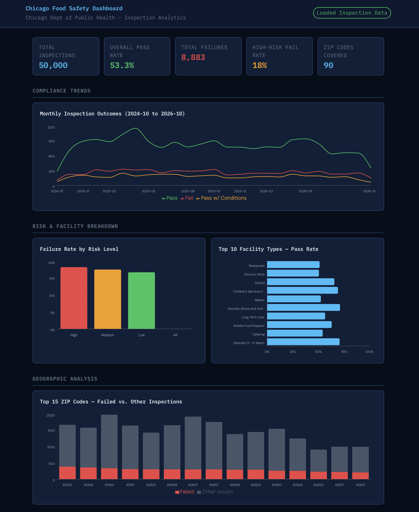
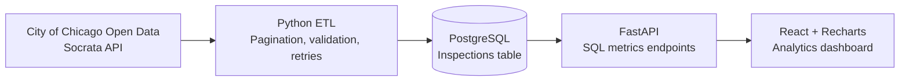

# Chicago Food Safety Dashboard


**Chicago inspection data → Python ETL → PostgreSQL → FastAPI → React/Recharts**

A full-stack data engineering and analytics project that turns public City of Chicago food inspection records into interactive inspection trends, compliance KPIs, facility comparisons, and ZIP-code breakdowns.

> **Data freshness:** This is an on-demand **snapshot**, not a live feed. Re-run the ETL to refresh PostgreSQL. The demonstrated local run loaded **50,000 inspection records**; your results will depend on when and how much data you ingest.

## Dashboard

The dashboard includes:

- Five KPIs: total inspections, pass rate, failures, high-risk failure rate, and ZIP codes covered
- Monthly outcomes (Pass, Fail, Pass with Conditions), with the displayed date range based on returned data
- Failure rates by inspection risk level
- Pass rates for the ten most frequently inspected facility types
- Top 15 ZIP codes by failed inspections, with stacked failed and other-result counts

## Dashboard Preview



## Architecture



The ETL fetches inspection records in 1,000-record pages, normalizes fields, and performs full-record upserts keyed on `inspection_id`. It uses request timeouts, limited retries, and transaction rollback on failed loads. The backend runs SQL aggregates against PostgreSQL; the frontend queries those API endpoints.

## Technology

| Layer | Stack |
| --- | --- |
| Data ingestion | Python, Requests |
| Database | PostgreSQL, psycopg2 |
| Backend | FastAPI, Uvicorn |
| Frontend | React 18, Recharts 2, Vite 8 |
| Quality | Python `unittest`, GitHub Actions, npm build checks |

Recharts 2 remains in use; its v3 migration is a future maintenance task.

## Repository structure

```text
chicago-food-dashboard/
├── backend/
│   ├── main.py
│   └── requirements.txt
├── etl/
│   └── etl.py
├── frontend/
│   ├── index.html
│   ├── package.json
│   ├── package-lock.json
│   ├── vite.config.mjs
│   └── src/
│       ├── App.jsx
│       ├── App.css
│       └── main.jsx
├── tests/
│   ├── test_api.py
│   ├── test_etl.py
│   ├── test_pipeline.py
│   └── test_postgres_integration.py
├── .github/workflows/ci.yml
├── .env.example
└── README.md
```

## Run locally

### Prerequisites

- Python **3.12** (the version used during local verification)
- Node.js supported by Vite 8 (Node 24 LTS recommended)
- PostgreSQL 16+ or an equivalent compatible PostgreSQL server

### 1. Clone and configure

```bash
git clone https://github.com/SayojyaPatil/chicago-food-dashboard.git
cd chicago-food-dashboard
cp .env.example .env
```

Create an empty PostgreSQL database named `food_inspections` (or use another name). Edit `.env` with **your own local credentials**:

```dotenv
DB_HOST=127.0.0.1
DB_PORT=5432
DB_NAME=food_inspections
DB_USER=your_database_user
DB_PASSWORD=your_local_password
CORS_ORIGINS=http://localhost:5173,http://127.0.0.1:5173
ETL_LIMIT=1000
```

If port 5432 is in use, map an **isolated** local Docker PostgreSQL container to another host port, such as 5434, and set `DB_PORT` accordingly. Do not add `.env` to Git.

### 2. Install dependencies and ingest data

From the repository root:

```bash
python3.12 -m venv .venv
source .venv/bin/activate
python -m pip install -r backend/requirements.txt
python etl/etl.py
```

The ETL creates the inspections table and indexes if needed, then upserts records. Start with `ETL_LIMIT=1000`; after verifying ingestion you can increase the limit (for example, `ETL_LIMIT=50000`) and rerun.

### 3. Start FastAPI

From the repository root, with `.venv` activated:

```bash
python -m uvicorn backend.main:app --reload --port 8000
```

- [API docs](http://localhost:8000/docs)
- [Process health](http://localhost:8000/health)
- [Database health](http://localhost:8000/health/db)

The database health check returns an error status when the database is unavailable. If port 8000 is occupied, run Uvicorn on another port and set the frontend's `VITE_API_URL` to that origin.

### 4. Start React

In a separate terminal:

```bash
cd frontend
npm ci
npm run dev
```

Open <http://localhost:5173>. The app defaults to `http://localhost:8000`; to override it, create `frontend/.env.local`:

```dotenv
VITE_API_URL=http://localhost:8001
```

Restart Vite after changing environment variables.

### 5. Tests and build

From the repository root:

```bash
python -m unittest discover -s tests -v
```

The database integration test is skipped locally unless `RUN_DB_INTEGRATION=1` and `TEST_DATABASE_URL` reference a **dedicated disposable test database**. GitHub Actions provisions its own PostgreSQL service.

From `frontend/`:

```bash
npm audit
npm run build
```

**Local verification:** 16 tests passed, 1 integration test skipped, production build successful, and 0 npm vulnerabilities reported.

## API routes

| Method | Endpoint | Purpose |
| --- | --- | --- |
| GET | `/health` | API process status |
| GET | `/health/db` | PostgreSQL connectivity |
| GET | `/metrics/kpi-summary` | Overall inspection counts and rates |
| GET | `/metrics/pass-fail-trend` | Monthly outcomes within a rolling 24-month window |
| GET | `/metrics/risk-distribution` | Failure rates by risk category |
| GET | `/metrics/top-facility-types` | Pass rates for common facility types |
| GET | `/metrics/zip-fail-rates` | ZIP-code inspection and failure counts |

## Data and interpretation

**Source:** [City of Chicago Food Inspections dataset](https://data.cityofchicago.org/resource/4ijn-s7e5.json).

- The 50,000-row run is a **recent-record sample**, not the full history of Chicago inspections.
- A pass rate here means `results = 'Pass'`; `Pass w/ Conditions` is displayed separately in monthly trends.
- The trend query uses a rolling **24-month window**; the first and most recent months may be partial.
- ZIP-code stacked charts show failed vs. other inspection results; the latter includes statuses beyond Pass.
- Refreshing the ETL may change totals and rankings.

## Security and limitations

- Credentials are read from environment variables; commit only `.env.example`, never `.env`.
- CORS origins are configurable with `CORS_ORIGINS` and default to local development origins.
- The backend currently opens synchronous database connections per request; connection pooling would be a future enhancement.
- Ingestion is manual rather than scheduled and capped by `ETL_LIMIT`.
- No production authentication or published live demo is provided by this repository.
