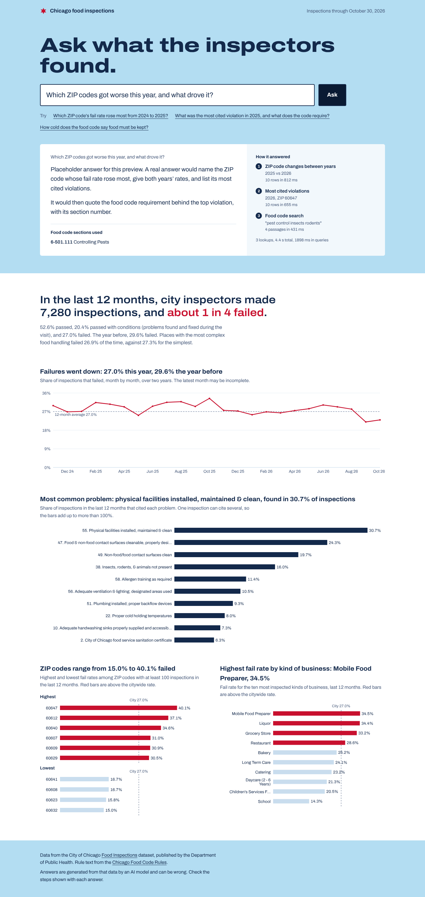
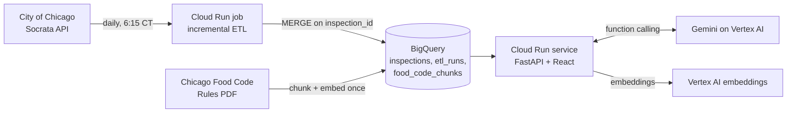

# Chicago Food Inspections

[Live URL (v1, Railway)](https://chicago-food-frontend-production.up.railway.app)

**Chicago inspection data, refreshed daily into BigQuery, with a dashboard and an analyst agent you can ask questions in plain English.**

The agent answers with figures pulled live from the data and with the Chicago Food Code rule behind each violation. It shows every lookup it made while answering.



*The preview uses synthetic data on a local PostgreSQL database, and the answer text is a placeholder, not a real model response.*

## Two ways to run it

| | v1: PostgreSQL (original) | v2: Google Cloud |
| --- | --- | --- |
| Data | On-demand snapshot, `python etl/etl.py` | Daily incremental load: Cloud Scheduler → Cloud Run job → BigQuery `MERGE` |
| API | FastAPI + PostgreSQL | Same FastAPI app, `DATA_BACKEND=bigquery` |
| Agent | Not available | Gemini on Vertex AI with tool calling and food code search (RAG) |
| Hosting | Railway | Cloud Run, all infrastructure in Terraform |
| Deploys | Railway | GitHub Actions with Workload Identity Federation (no key files) |

`DATA_BACKEND` defaults to `postgres`, so v1 keeps working unchanged. **Deploy v2 with [docs/GCP_DEPLOY.md](docs/GCP_DEPLOY.md).**

## Architecture (v2)



### How the agent works

1. The question passes a length check, then goes to Gemini along with descriptions of six tools.
2. Five tools are **fixed, parameterized BigQuery queries**: citywide totals, ZIP fail rates, year-over-year ZIP changes, most cited violations, and business lookup. The model picks a tool and fills in arguments; it never writes SQL. Arguments are validated and bound as query parameters.
3. The sixth tool, **food code search**, embeds the question and runs BigQuery `VECTOR_SEARCH` over the Chicago Food Code Rules, chunked one section per row.
4. Guardrails:
   - Text that reads like instructions is stripped from tool results before the model sees it.
   - Each question is capped at 6 tool calls.
   - Every number in the answer is checked against the tool results, and any number that doesn't match is flagged in the UI.
   - Requests are rate-limited per client.
5. The API streams each lookup to the browser as it happens (newline-delimited JSON), then streams the answer and the cited sections.

### Evaluation

`evals/questions.json` holds 29 questions across data, rules, combined and safety cases. Ground truth is computed at eval time by running the same query directly, so the expected answers track the daily refresh. `python -m evals.run_evals` scores:

- tool choice and arguments
- answer correctness
- retrieval of the right code section
- grounding of every stated number
- safety: no prompt leaks, no tool use on off-topic requests
- P50/P95 latency

The eval workflow runs it on pull requests that touch the agent and fails below set thresholds.

Results are written to `evals/results/` after each run.

## Technology

| Layer | Stack |
| --- | --- |
| Data ingestion | Python, Requests; BigQuery load + MERGE (v2) |
| Database | PostgreSQL, psycopg2 (v1); BigQuery (v2) |
| Backend | FastAPI, Uvicorn |
| AI | Gemini on Vertex AI (function calling), Vertex AI embeddings, BigQuery `VECTOR_SEARCH` |
| Cloud | Cloud Run (service + job), Cloud Scheduler, Artifact Registry, Cloud Build, Terraform |
| Frontend | React 18, Recharts 2, Vite 8, Archivo (self-hosted) |
| Quality | Python `unittest`, agent eval suite, GitHub Actions, npm build checks |

Recharts 2 remains in use; its v3 migration is a future maintenance task.

## Repository structure

```text
chicago-food-dashboard/
├── backend/
│   ├── main.py              # API routes, agent endpoint, static files
│   ├── sql.py               # metric queries for PostgreSQL and BigQuery
│   ├── bigquery_store.py
│   └── agent/               # tools, retrieval, guardrails, model adapter, loop
├── etl/
│   ├── etl.py               # v1: Socrata -> PostgreSQL
│   └── bq_load.py           # v2: incremental Socrata -> BigQuery
├── scripts/ingest_food_code.py
├── evals/                   # golden questions, scorer, runner
├── frontend/                # React app
├── infra/terraform/         # all GCP resources
├── tests/
├── docs/GCP_DEPLOY.md
├── Dockerfile               # one image for the web service and the ETL job
├── cloudbuild.yaml
└── .github/workflows/       # ci.yml, deploy.yml, agent-evals.yml
```

## Run locally

### Prerequisites

- Python **3.12** (the version used during local verification)
- Node.js supported by Vite 8 (Node 24 LTS recommended)
- PostgreSQL 16+ or an equivalent compatible PostgreSQL server

### 1. Clone and configure

```bash
git clone https://github.com/SayojyaPatil/chicago-food-dashboard.git
cd chicago-food-dashboard
cp .env.example .env
```

Create an empty PostgreSQL database named `food_inspections` (or use another name). Edit `.env` with **your own local credentials**:

```dotenv
DB_HOST=127.0.0.1
DB_PORT=5432
DB_NAME=food_inspections
DB_USER=your_database_user
DB_PASSWORD=your_local_password
CORS_ORIGINS=http://localhost:5173,http://127.0.0.1:5173
ETL_LIMIT=1000
```

If port 5432 is in use, map an **isolated** local Docker PostgreSQL container to another host port, such as 5434, and set `DB_PORT` accordingly. Do not add `.env` to Git.

### 2. Install dependencies and ingest data

From the repository root:

```bash
python3.12 -m venv .venv
source .venv/bin/activate
python -m pip install -r backend/requirements.txt
python etl/etl.py
```

The ETL creates the inspections table and indexes if needed, then upserts records. Start with `ETL_LIMIT=1000`; after verifying ingestion you can increase the limit (for example, `ETL_LIMIT=50000`) and rerun.

### 3. Start FastAPI

From the repository root, with `.venv` activated:

```bash
python -m uvicorn backend.main:app --reload --port 8000
```

- [API docs](http://localhost:8000/docs)
- [Process health](http://localhost:8000/health)
- [Database health](http://localhost:8000/health/db)

The database health check returns an error status when the database is unavailable. If port 8000 is occupied, run Uvicorn on another port and set the frontend's `VITE_API_URL` to that origin.

### 4. Start React

In a separate terminal:

```bash
cd frontend
npm ci
npm run dev
```

Open <http://localhost:5173>. In development, Vite forwards API calls to `http://localhost:8000`. To call a different API origin, create `frontend/.env.local`:

```dotenv
VITE_API_URL=http://localhost:8001
```

Restart Vite after changing environment variables.

### 5. Tests and build

From the repository root:

```bash
python -m unittest discover -s tests -v
```

The database integration test is skipped locally unless `RUN_DB_INTEGRATION=1` and `TEST_DATABASE_URL` reference a **dedicated disposable test database**. GitHub Actions provisions its own PostgreSQL service.

From `frontend/`:

```bash
npm audit
npm run build
```

**Local verification:** 61 tests passed, 1 PostgreSQL integration test skipped (it runs in CI), and the production build succeeds. The agent, ETL and eval-scorer tests use fakes, so they need no cloud credentials.

## API routes

| Method | Endpoint | Purpose |
| --- | --- | --- |
| GET | `/health` | API process status |
| GET | `/health/db` | PostgreSQL connectivity |
| GET | `/metrics/kpi-summary` | Overall inspection counts and rates |
| GET | `/metrics/pass-fail-trend` | Monthly outcomes within a rolling 24-month window |
| GET | `/metrics/risk-distribution` | Failure rates by risk category |
| GET | `/metrics/top-facility-types` | Pass rates for common facility types |
| GET | `/metrics/zip-fail-rates` | ZIP-code inspection and failure counts |
| GET | `/metrics/freshness` | Newest inspection loaded and last successful refresh |
| POST | `/agent/ask` | Ask the agent (BigQuery backend); streams NDJSON events |

## Data and interpretation

**Source:** [City of Chicago Food Inspections dataset](https://data.cityofchicago.org/resource/4ijn-s7e5.json).

Every rate on the page and in the agent uses the same rules:

- **Only real outcomes count:** Pass, Pass w/ Conditions, and Fail. Records such as "Out of Business", "No Entry" or "Not Ready" are left out, because no food-safety inspection took place.
- **Pass with conditions** means the inspector found problems that were fixed during the visit.
- **"Last 12 months"** ends at the newest inspection loaded, not today's date, so an older snapshot still shows a full year.
- **Violation shares** are the percentage of inspections that cited each checklist item. One inspection can cite several, so shares add up to more than 100%.
- **ZIP code rates** only include ZIP codes with at least 100 inspections in the period, so small samples don't top the list.

The dashboard answers four questions: is the fail rate rising or falling, what goes wrong most often, which ZIP codes have the highest and lowest fail rates, and which kinds of business fail most.

## Security and limitations

- Credentials come from environment variables (v1) or service accounts with narrow roles (v2). There are no key files: GitHub Actions signs in through Workload Identity Federation.
- The agent's tools are read-only, parameterized queries. The model cannot run arbitrary SQL.
- The agent can be wrong. Numbers it states that don't appear in its tool results are flagged in the UI, and every lookup is shown.
- The per-client rate limit is held in memory per Cloud Run instance, which is enough for a demo but not a strict quota.
- The eval set is small (29 questions) and hand-written. It catches regressions; it doesn't prove general accuracy.
- v1 opens a database connection per request and ingests manually. v2 replaces both with BigQuery and a daily job.
